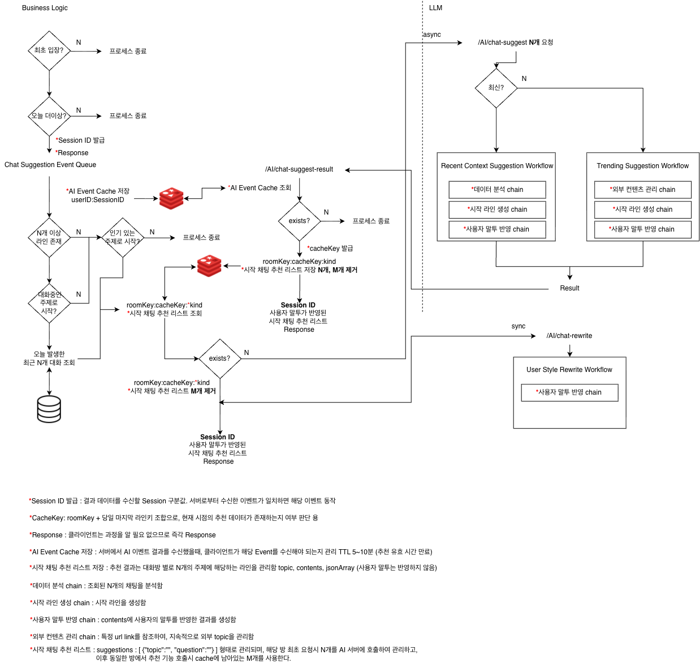

# Conversation Start Recommendation

기업용 메신저에서 사용자가 대화를 시작해야 하는 순간에 자연스러운 **대화 시작 문장**을 추천하는 기능입니다.

MVP 단계에서는 suggestion_type=TRENDING 흐름을 우선 구현했습니다. Trending 요청에서는 외부 Trending Topic을 활용하고, 사전에 생성된 base_question을 메신저에서 바로 사용할 수 있는 추천 문장으로 제공합니다.



---

## Overview

Conversation Start 기능은 요청의 `suggestion_type`에 따라 추천 생성 경로를 분기합니다.

```text
Conversation Start Request
        │
        ▼
Suggestion Type 확인
        │
        ├── RECENT_CONTEXT
        │       │
        │       ▼
        │   최근 대화 기반 추천 흐름
        │   (현재는 mock/scaffold 단계)
        │
        └── TRENDING
                │
                ▼
          Trending Topic 기반 추천
          (MVP 구현 범위)
```

추천 문장은 단순한 Small Talk 문구가 아니라 **실제 Trending Topic과 연결된 가벼운 질문**을 목표로 합니다. 이를 통해 사용자는 별도의 대화 소재를 고민하지 않아도 현재 시점에 어색하지 않은 첫 문장을 선택할 수 있습니다.

---

## Structure

```text
app/features/conversation_start/
├── conversation_start_router.py      # FastAPI endpoint
├── conversation_start_schemas.py     # Request / Response schema
├── conversation_start_state.py       # LangGraph state contract
├── conversation_start_graph.py       # Suggestion type routing graph
└── nodes/
    ├── load_trending_context.py      # Trending context 조회
    ├── generate_trending_candidates.py
    ├── select_result.py
    ├── analyze_recent_context.py     # Recent Context scaffold
    └── generate_recent_candidates.py # Recent Context mock candidate
```

관련 테스트는 `app/tests/conversation_start/`에 위치합니다.

```text
app/tests/conversation_start/
├── test_request_schema.py
└── test_router.py
```

---

## API

Conversation Start 기능은 다음 endpoint를 제공합니다.

```text
POST /ai/v1/chat/suggestions/generate
```

Request는 추천 요청의 식별 정보와 추천 타입, 최근 메시지, 생성 옵션을 포함합니다.

```json
{
  "session_id": "session-1",
  "user_id": "user-1",
  "room_id": "room-1",
  "suggestion_type": "TRENDING",
  "messages": [],
  "options": {
    "max_suggestions": 3,
    "max_length": 80,
    "language": "ko"
  }
}
```

Response는 추천 문장을 `topic`과 `question` 단위로 반환합니다.

```json
{
  "session_id": "session-1",
  "suggestions": [
    {
      "topic": "AI 이미지",
      "question": "요즘 AI 이미지 앱 많이 보이던데 써본 적 있어요?"
    }
  ]
}
```

구현 포인트:

* `ConversationStartRequest`에서 `suggestion_type`, `messages`, `options`를 명시적으로 검증합니다.
* `RequestOptions.max_suggestions`를 통해 응답 개수를 제어합니다.
* `ConversationStartResponse`는 클라이언트가 바로 렌더링하기 쉽도록 `topic`과 `question`만 노출합니다.

---

## Recent Context

Recent Context 흐름은 대화방의 최근 메시지를 분석해 현재 대화와 이어지는 질문을 생성하기 위한 경로입니다.

```text
RECENT_CONTEXT
    │
    ▼
analyze_recent_context
    │
    ▼
generate_recent_candidates
    │
    ▼
select_result
```

다만 MVP 범위에서는 `TRENDING` 타입을 우선 검증하기 위해 Recent Context는 mock 기반 scaffold로 유지했습니다. 추후에는 최근 메시지 요약, 발화자 관계, 대화 의도, 업무 맥락 등을 분석한 뒤 실제 LLM 기반 질문 생성으로 확장할 예정입니다.

---

## Trending

Trending 흐름은 외부 Trending Topic을 활용해 대화 소재를 제공하기 위한 MVP 핵심 구현입니다.

전체 Trending Topic 처리 흐름은 trending feature에서 수행하고, Conversation Start에서는 해당 결과를 조회해 추천 응답 형태로 변환합니다.

```text
Google Trends
    │
    ▼
Topic Prefilter
    │
    ▼
Google News Enrichment
    │
    ▼
News Context Evaluation
    │
    ▼
Base Question Generation
    │
    ▼
Trending Context 저장
```

구현 포인트:

* `TrendingService`를 통해 이미 평가 및 가공된 Trending Context를 조회합니다.
* 각 topic의 `base_question`을 추천 문장 후보로 사용합니다.
* `base_question`이 없는 topic은 후보에서 제외해 빈 질문이 응답에 섞이지 않도록 처리합니다.
* 최종 응답 개수는 `options.max_suggestions` 기준으로 제한합니다.

Trending Context 갱신은 서버 기동 시 자동으로 실행하지 않고, 별도 API를 통해 명시적으로 호출합니다.

```text
POST /ai/v1/trending/refresh
```

이 API는 Google Trends / News / LLM 평가처럼 외부 의존성이 있는 refresh 흐름을 실행하고, 저장된 topic 개수를 반환합니다.

---

## Prompt

현재 MVP에서는 Trending Topic 평가 및 `base_question` 생성을 위한 LLM Prompt를 사용합니다.

주요 역할은 다음과 같습니다.

```text
Trending Evaluation
    대화 소재로 적합한 Trending Topic인지 평가

News Context Evaluation
    Topic과 연결된 뉴스 맥락 중 대화에 활용할 정보를 선별

Base Question Generation
    메신저에서 바로 사용할 수 있는 가벼운 질문 형태로 변환
```

향후 사용자별 말투를 반영하는 Rewrite 단계가 추가되면 관련 Prompt 정책도 함께 확장할 예정입니다.

---

## Recommendation Flow

현재 구현된 Conversation Start Graph는 다음 흐름으로 동작합니다.

```text
Request
   │
   ▼
route_suggestion
   │
   ├── RECENT_CONTEXT (Not Implemented)
   │       │
   │       ▼
   │   analyze_recent_context
   │       │
   │       ▼
   │   generate_recent_candidates
   │
   └── TRENDING
           │
           ▼
       load_trending_context
           │
           ▼
       generate_trending_candidates
           │
           ▼
        select_result
           │
           ▼
        Recommendation
```

MVP에서는 `TRENDING` 경로를 기준으로 실제 추천 응답을 구성했습니다. `RECENT_CONTEXT` 경로는 이후 실제 대화 분석 로직과 LLM 생성 로직을 연결하기 쉽도록 동일한 Graph 구조 안에 미리 분리해두었습니다.

---

## Current MVP Scope

구현 완료:

* `POST /ai/v1/chat/suggestions/generate` API
* `ConversationStartRequest` / `ConversationStartResponse` schema
* LangGraph 기반 `suggestion_type` routing
* `TRENDING` 타입 추천 생성 흐름
* Trending Context의 `base_question` 기반 후보 생성
* `max_suggestions` 기준 최종 추천 개수 제한
* schema 및 candidate 생성 로직 테스트

추후 개선 예정:

* Recent Context 실데이터 분석 및 LLM 기반 질문 생성
* 후보 문장 Validation 노드 연결
* 사용자별 말투 반영 Rewrite 노드 연결
* `max_length`, `language` 옵션의 실제 생성 정책 반영
